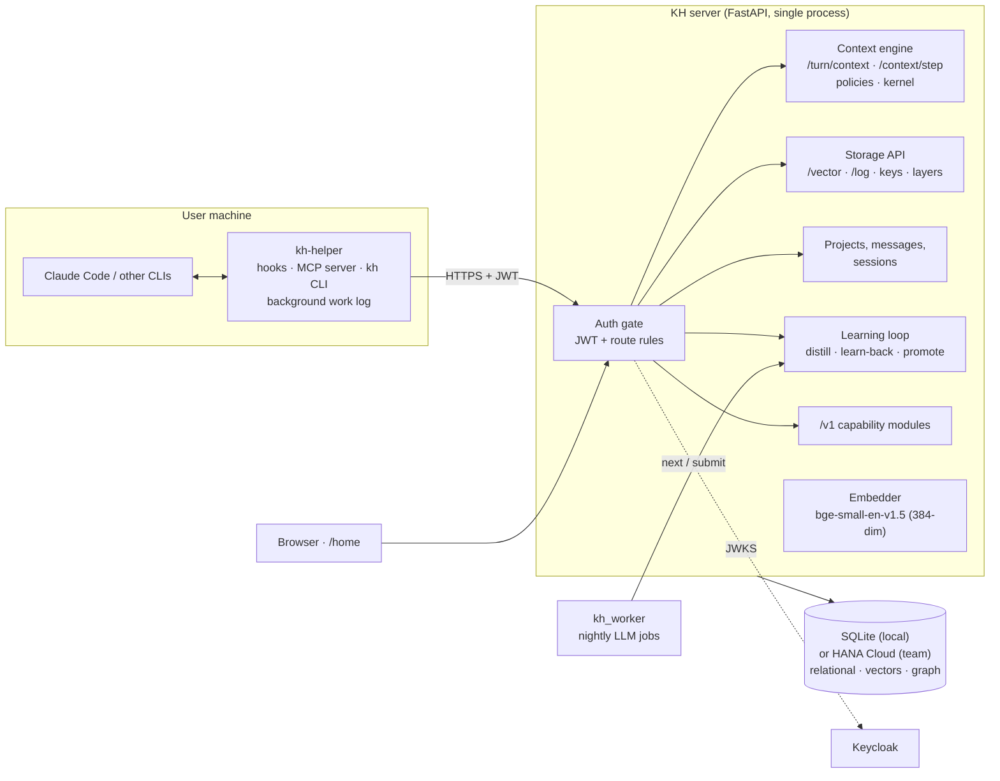

# Knowledge Hub v6.5

A shared memory and context engine for AI coding agents such as Claude Code.

Knowledge Hub (KH) stores what agents and people learn while they work: knowledge, work logs, findings, policies and lessons. Each item belongs to a project. On every user message, KH hands the agent a compact, permission-checked context block. The server runs **no LLM to answer requests**. It does deterministic storage, permissions and retrieval, and the calling agent does all the reasoning.

It started as a demo for my team: the goal is to help people work together better by managing and sharing context, so teammates and their AI coding agents build on each other's work instead of starting from zero. It was built from a written design specification, which is kept private and not published in this repository.

## Features

- **Per-turn context.** `GET /turn/context` returns the project match, the action menu, findings, people and things mentioned, and nearby lessons. A Claude Code hook prints it into the model's context for each message.
- **Step-wise retrieval.** `POST /context/step` returns one bounded context pack (6000 characters by default) for each step of work, mixing entities, work logs, knowledge and lessons.
- **Policies and kernel.**
  - An action table maps an intent label (such as `save knowledge`) to an ordered plan.
  - A tagged kernel has three tiers: common, project and personal. Rules are resolved by slot, and locked rules cannot be overridden.
  - Tool guards check tool calls before they run.
- **Project isolation.** Every row belongs to one project. Special projects:
  - `orchestrator`: the shared directory.
  - `lesson-learned`: reviewed lessons that everyone can read.
  - `market`: public posts.
  - One `personal-<email>` workspace per user.
- **Identity and permissions.** Keycloak JWTs, a route-to-permission rule table and per-project access levels. Without an issuer configured, the server runs in an open local mode.
- **Learning loop.** Work logs are distilled into keyed lessons for review. Personal rules held by enough people are promoted to the common tier.
- **Client package.** `kh-helper` provides the `kh` CLI, Claude Code hooks, the `knowledge-hub` MCP server and an automatic background work log.
- **`/v1` capability modules.** Namespaces for external multi-agent systems, with 14 modules:

  | Module | What it provides |
  |---|---|
  | registry | namespaces, manifests, quotas |
  | coord | leases with fencing, idempotency keys, side-effect approvals |
  | events | append-only events with gapless cursors |
  | principals | service principals with signed tokens |
  | records | typed records with revisions |
  | rules | rule graph, scans, gate |
  | redaction | secret and PII masking |
  | items | distilled knowledge items |
  | retrieval | per-namespace context steps |
  | vault | sealed items with canaries |
  | packs | versioned document packs, quotes, Q&A |
  | metrics | metric points, A/B compare, rollback |
  | outbox | signed webhooks |
  | lifecycle | export, import, purge |

- **Two storage backends behind one storage layer.** SQLite for local work and demos, SAP HANA Cloud for a shared team instance. Every table has DDL for both, and the layer is designed to extend to PostgreSQL (pgvector).

## Architecture



A typical user turn:

1. **Session start.** The SessionStart hook loads the merged kernel and the user's personalization.
2. **User message.** The UserPromptSubmit hook prints the KH TURN CONTEXT block for that message.
3. **Agent work.** The agent picks an action, fetches its plan, and calls `/context/step` for each step. Writes go through `/vector/add` into the owning project.
4. **Before a tool runs.** The PreToolUse hook checks tool guards.
5. **End of the turn.** The Stop hook queues a background job that summarizes the turn into one work log.

## Quick start

Requires Python 3.12.

```bash
git clone https://github.com/ViHa0509/knowlegeHub.git
cd knowlegeHub
python -m venv .venv
.venv/Scripts/python -m pip install -r requirements.txt      # on Linux/macOS: .venv/bin/python
.venv/Scripts/python -m pip install -e tools/kh-helper       # optional: the client
```

Run the server locally. It starts in open mode, with storage in `hooks.db` and the hash embedder:

```bash
KH_EMBEDDER=hash .venv/Scripts/python -m uvicorn main:app --port 8000
```

Then open:

- `http://localhost:8000/docs` for the interactive API reference
- `http://localhost:8000/health` for a health check

Store a piece of knowledge, then search for it:

```bash
curl -X POST localhost:8000/vector/add -H "Content-Type: application/json" \
  -d '{"text":"Deploys run from the release branch only.","scope":"knowledge","metadata":{"scope":"knowledge","project":"demo"}}'

curl -X POST localhost:8000/vector/query -H "Content-Type: application/json" \
  -d '{"text":"which branch do deploys run from","project":"demo","scope":"knowledge"}'
```

The `hash` embedder only matches shared words, so its scores stay low. For real semantic search, and for `/context/step` packs (which drop items scoring below 0.68), install the optional `sentence-transformers` and `torch` packages and use the default `KH_EMBEDDER=local`.

## Configuration

All settings come from environment variables. The main ones:

| Variable | Default | Purpose |
|---|---|---|
| `KH_HOST`, `KH_PORT` | `0.0.0.0`, `8000` | Bind address |
| `KH_STORE_BACKEND` | `sqlite` | Relational store: `sqlite` or `hana` |
| `KH_VECTOR_BACKEND` | `sqlite` | Vector store: `sqlite`, `hana` or `chroma` |
| `GRAPH_BACKEND` | `sqlite` | Graph store: `sqlite` or `hana` |
| `KH_HOOKS_DB` | `./hooks.db` | SQLite file for local storage |
| `KH_EMBEDDER` | `local` | `local` (bge-small-en-v1.5), `remote`, `auto` or `hash` (deterministic, no model) |
| `KH_AUTH_ISSUER` | unset | Keycloak realm URL. When unset, sign-in is off (open mode) |
| `HANA_HOST`, `HANA_PORT`, `HANA_USERNAME`, `HANA_PASSWORD`, `HANA_SCHEMA` | unset | HANA Cloud connection |
| `KH_FEEDBACK_CRON`, `KH_MESSAGE_CRON`, `KH_CAPS_CRONS` | on | Background jobs |
| `KH_CAP_<MODULE>` | module default | Switch a `/v1` module on or off |

The full list, with exact defaults, is in [`app/config.py`](app/config.py).

KH is **English-only**. Clients translate everything before sending it, so stored text and embeddings stay consistent.

## Project layout

```
main.py                 FastAPI app, lifespan, core routes, route-group loader
app/                    server modules (one route group per module)
  auth.py, auth_rules.json   identity and route permissions
  turn.py, step.py           per-turn context and step packs
  policy_actions/, kernel/   action table, plans, tagged kernel
  vector_*.py, sqldb.py      vector and relational storage (SQLite / HANA)
  distill.py, learnback.py, promote.py   learning loop
  caps/                      /v1 capability modules
worker/kh_worker/       nightly LLM jobs (distil, promote, daily)
tools/kh-helper/        client: kh CLI, hooks, MCP server, work log
seeds/                  seed kernel rules, actions and tags
tests/                  pytest suites per area
docs/                   build contract, deviations, integration notes
.claude/skills/         project skills for Claude Code
```

## Client: kh-helper

```bash
kh login              # sign in through Keycloak
kh setup              # install the Claude Code hooks and the knowledge-hub MCP server
kh status             # show sign-in and connection state
kh call GET "/turn/context?text=how%20do%20we%20deploy"
```

See [`tools/kh-helper/README.md`](tools/kh-helper/README.md) for details.

## Development

```bash
.venv/Scripts/python -m pytest -q                      # full suite (~2 min, no network)
.venv/Scripts/python -m pytest -q tests/caps           # one area
```

Tests use the deterministic `hash` embedder, temporary SQLite stores and fake LLMs. They need no network, model download or database server.

Before changing code, read [`docs/rebuild-contract.md`](docs/rebuild-contract.md) for the shared conventions. Record any departure from the design in [`docs/deviations.md`](docs/deviations.md).

## Status and limits

- This is a demo for team use, not a hardened product. Where the design leaves a value open, the choice made is listed in [`docs/deviations.md`](docs/deviations.md).
- Not yet built:
  - a PostgreSQL (pgvector) storage backend;
  - five roadmap `/v1` modules (people, daily, outcomes, learn, improve);
  - the Windows offline installer for `kh-helper`;
  - half of the kernel tag vocabulary (151 of 299 tags are seeded).
- Not covered by tests: sync with a second KH instance, Keycloak account provisioning, and event delivery to a sidecar. These need live services.

## License

[MIT](LICENSE)
